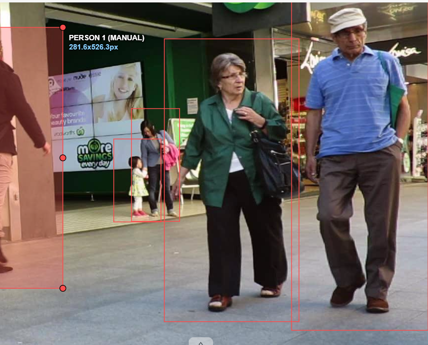
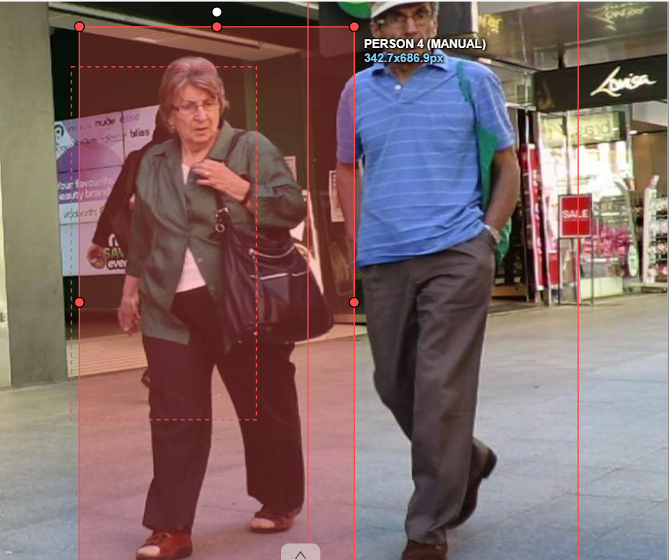
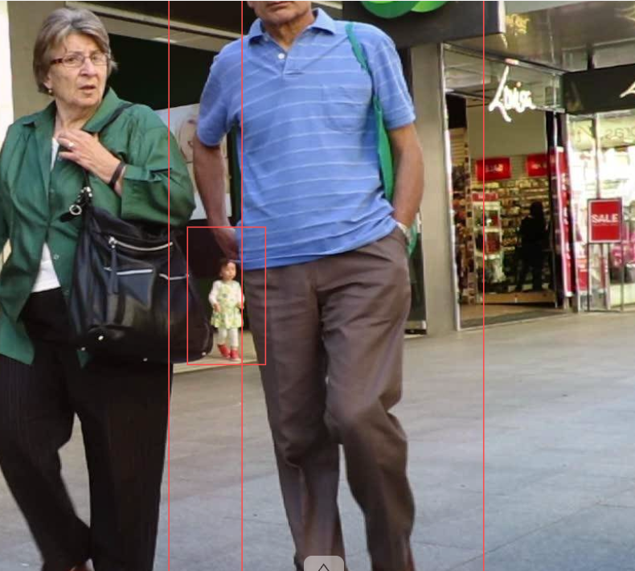

# Báo cáo cá nhân — HoVaTen-MSSV

Đổi tên file theo quy tắc `MSSV_HoTen.md`. Ví dụ: `20241234_NguyenVanAn.md`.

Đoạn video: MOT17-09, 150 frame (frame 1–150), nguồn MOTChallenge, giấy phép CC BY-NC-SA 3.0.

## 0. Thông tin học viên

- Họ tên: Hoàng Quang Trường
- MSSV: 2A202603347
- Mã đề (A/B/C): C
- Email: truonghoangg25@gmail.com
- Link repository: https://github.com/truonghoangg25/K5-L2-DAY05-HoangQuangTruong-2A202603347-MOTTracking
- Giờ bắt đầu:
- Giờ kết thúc:

## 1. Xem trước đoạn video (CP0)

Ghi **trước khi vẽ**, mỗi người một dòng.

| Mã | Frame xuất hiện | Frame cuối thấy được | Rẽ / dừng / đổi tốc độ ở frame | Bị che ở frame | Ghi chú |
|---|---|---|---|---|---|
| P1 | 1 | 150* | | 1–38, 109–119 (che một phần); từ 120 đến hết (che hoàn toàn) | |
| P2 | 1 | 147* | | 105–110 (che một phần); 111–140 (khuất hoàn toàn); từ 142 (che một phần); từ 147 (outside) | |
| P3 | 1 | 107* | | 89–104 (che một phần); từ 105 đến hết (khuất hoàn toàn) | |
| P4 | 1 | 150* | | Không ghi nhận | |
| P5 | 1 | 150* | | 1–66 (che một phần) | |

*Frame cuối thấy được lấy theo frame cuối có box trong file MOT xuất ra (đổi từ frame CVAT bắt đầu ở 0 sang frame video bắt đầu ở 1), không phải số ghi nhận độc lập ở lượt xem trước khi vẽ. Các mốc che là ghi nhận đã cung cấp; không tự suy đoán mốc rẽ, dừng hoặc đổi tốc độ.

## 2. Keyframe và thời gian (CP1, CP4)

Số keyframe lấy từ kết quả `src/check_submission.py`.

| Mã | Số keyframe | Keyframe ở frame | Số frame có mặt | Keyframe / 100 frame | Thời gian (phút) | Chỗ khó |
|---|---:|---|---:|---:|---|---|
| P1 | 22 | 0, 10, 20, 30, 32, 33, 34, 35, 36, 37, 38, 40, 50, 60, 70, 80, 90, 100, 109, 110, 130, 149 | 128 | 17.2 | | Nhiều keyframe nhất; tập trung quanh các đoạn bị che và thay đổi trạng thái |
| P2 | 11 | 0, 10, 20, 30, 60, 100, 105, 106, 110, 141, 142 | 117 | 9.4 | | Đoạn bị che, khuất hoàn toàn và xuất hiện lại |
| P3 | 6 | 0, 10, 20, 30, 89, 90 | 107 | 5.6 | | Đoạn bị che từ frame 89–106 theo chỉ số CVAT |
| P4 | 15 | 0, 10, 20, 30, 40, 50, 60, 80, 90, 100, 110, 120, 130, 140, 149 | 150 | 10.0 | | |
| P5 | 17 | 0, 10, 20, 30, 40, 50, 60, 68, 70, 80, 90, 100, 110, 120, 130, 140, 149 | 150 | 11.3 | | |
| **Tổng** | **71** | | **652** | **10.9** | | |

Keyframe / 100 frame của cả bài = tổng keyframe ÷ tổng số frame có mặt × 100 = 71 ÷ 652 × 100 = **10.9 keyframe / 100 frame**.

Bạn đặt keyframe nhiều nhất ở người nào? Vì sao (người đó rẽ, dừng, lại gần camera hay bị che)?

P1 có nhiều keyframe nhất (22 keyframe). Các keyframe dày hơn ở các frame 32–38 và 109–110; đây là những vùng gần các đoạn P1 bị che một phần. Dữ liệu checker xác nhận vị trí keyframe, nhưng không đủ căn cứ để kết luận P1 rẽ, dừng hoặc lại gần camera.

## 3. Đoạn bị che (CP2)

Người bị che: `P2`

| Mốc | Frame |
|---|---:|
| Bắt đầu bị che một phần (bật `occluded`) | 105 (CVAT) |
| Mất hẳn (bật `outside`) | 111 (CVAT) |
| Hiện lại (tắt `outside`) | 140 (CVAT) |
| Thấy rõ trở lại (tắt `occluded`) | 141 (CVAT) |

- Thời gian khuất hẳn: **30 frame (CVAT frame 111–140)** = **1 giây (ở 30 fps)**.
- Quyết định: **giữ cùng ID**.
- Lý do (trả lời 3 câu: khuất bao lâu so với 60 frame, ngoại hình có khớp, chỗ hiện lại có đúng hướng và tốc độ):

  Đoạn khuất hoàn toàn dài 30 frame, ngắn hơn ngưỡng 60 frame của lớp nên có thể giữ cùng ID. Khi hiện lại, tiếp tục dùng track P2 thay vì tạo ID mới. Việc xác nhận ngoại hình, hướng di chuyển và tốc độ tại thời điểm hiện lại cần dựa trên đối chiếu trực tiếp các frame; không có đủ ghi chép độc lập trong dữ liệu hiện có để mô tả chi tiết các đặc điểm đó. Theo timeline CVAT, P2 tắt `outside` ở frame 140, tắt `occluded` ở frame 141, bật `occluded` lại ở frame 142 và bật `outside` lần thứ hai ở frame 147.

Ảnh chụp màn hình:





## 4. Tự review ID (CP3)

Lượt 1 theo người (đi ngược từ frame 149 về 0 trên CVAT), lượt 2 theo cảnh (nhảy 10 frame). Ít nhất 3 dòng; không có lỗi thì ghi một dòng "đã kiểm hai lượt, không lỗi".

Loại lỗi dùng đúng một trong 7 mã: `id_switch`, `fragmentation`, `lost`, `merge`, `false_track`, `drift`, `flag`.

| Frame | Mã người | Loại lỗi | Mô tả một câu | Phát hiện ở lượt | Đã sửa? |
|---:|---|---|---|---|---|
| | | | | | |
| | | | | | |
| | | | | | |

Tổng hợp số lỗi theo loại:

| `id_switch` | `fragmentation` | `lost` | `merge` | `false_track` | `drift` | `flag` |
|---:|---:|---:|---:|---:|---:|---:|
| | | | | | | |

Lỗi nào chỉ lượt 2 (theo cảnh) mới thấy, lượt 1 (theo người) không thấy? Vì sao?

Chưa có ghi chép kết quả của hai lượt review nên không thể xác định lỗi cụ thể hoặc khẳng định không có lỗi. Về nguyên tắc, lượt 2 theo cảnh có thể phát hiện lỗi `merge` hoặc `id_switch` giữa hai người ở cùng khu vực mà lượt 1 theo từng người dễ bỏ sót, vì lượt 2 quan sát đồng thời quan hệ vị trí và sự liên tục ID giữa các đối tượng trong cùng frame.

## 5. File xuất và kết quả tự kiểm (CP4)

| Kiểm tra | Kết quả |
|---|---|
| Tên file MOT 1.1 | `HoangQuangTruong_mot.zip` |
| Tên file CVAT for video 1.1 | `HoangQuangTruong_cvat_video.zip` |
| Số track ID khác nhau trong `gt/gt.txt` (phải là 5) | **5 — Đúng** |
| Frame `outside` không có dòng trong `gt.txt` (đúng / sai) | **Đúng theo kết quả tự kiểm; không có lỗi hoặc cảnh báo** |
| Job đã completed trên CVAT máy cá nhân | Chưa xác nhận |

Dán phần tóm tắt in ra từ `src/check_submission.py`:

```text
Số frame in theo CVAT (bắt đầu từ 0). Trong gt.txt, frame_id = frame CVAT + 1.

=== File MOT 1.1: HoangQuangTruong_mot.zip ===
  Số track ID: 5   |   Tổng số box: 652
  [OK]        Đúng 5 track ID.

  Track | Frame có mặt | Số frame | Đoạn vắng (outside)
      1 |   0–149      |      128 | 120–129, 137–148
      2 |   0–146      |      117 | 111–140
      3 |   0–106      |      107 | -
      4 |   0–149      |      150 | -
      5 |   0–149      |      150 | -


=== File CVAT for video 1.1: HoangQuangTruong_cvat_video.zip ===

  Track | Nhãn   | Frame thấy | Keyframe | KF/100 frame | Frame occluded | Lần bật outside
      0 | person |        128 |       22 |         17.2 |             57 |               2
              Track 0: keyframe ở frame [0, 10, 20, 30, 32, 33, 34, 35, 36, 37, 38, 40, 50, 60, 70, 80, 90, 100, 109, 110, 130, 149]
      1 | person |        117 |       11 |          9.4 |             11 |               2
              Track 1: keyframe ở frame [0, 10, 20, 30, 60, 100, 105, 106, 110, 141, 142]
      2 | person |        107 |        6 |          5.6 |             18 |               1
              Track 2: keyframe ở frame [0, 10, 20, 30, 89, 90]
      3 | person |        150 |       15 |         10.0 |              0 |               0
              Track 3: keyframe ở frame [0, 10, 20, 30, 40, 50, 60, 80, 90, 100, 110, 120, 130, 140, 149]
      4 | person |        150 |       17 |         11.3 |             68 |               0
              Track 4: keyframe ở frame [0, 10, 20, 30, 40, 50, 60, 68, 70, 80, 90, 100, 110, 120, 130, 140, 149]

  Tổng: 71 keyframe / 652 frame có mặt = 10.9 keyframe / 100 frame
  [OK]        Đọc được 5 track từ annotations.xml.

=== Tóm tắt ===
  Lỗi: 0   |   Cảnh báo: 0
  Đạt. Dán phần tóm tắt này vào báo cáo mục 5.
```

## 6. Ba câu kết

1. Nếu được gán lại, bạn sẽ đặt keyframe khác ở đâu? Vì sao?

   Tôi sẽ kiểm tra kỹ hơn quanh các đoạn P1 bị che (đặc biệt gần frame 109–120) và P2 xuất hiện lại (quanh frame 140–147 theo chỉ số CVAT). Đây là các vùng có thay đổi trạng thái `occluded` / `outside`; đặt và kiểm tra keyframe sát các mốc này giúp hạn chế nội suy sai hoặc nối nhầm ID.

2. Có chỗ nào bạn không chắc "cùng ID hay ID mới"? Bạn đã quyết định và ghi chú thế nào?

   Có trường hợp P2 khuất hoàn toàn rồi xuất hiện lại. Tôi giữ cùng ID P2 vì thời gian khuất hoàn toàn là 30 frame, thấp hơn ngưỡng 60 frame của lớp. Các tiêu chí ngoại hình, hướng và tốc độ cần được đối chiếu trực tiếp tại frame xuất hiện lại; timeline đã ghi nhận các mốc bật/tắt `outside` và `occluded`.

3. Một lỗi ID trong job của bạn (nếu không còn sót, chọn lỗi đã sửa) có thể làm xe tự lái dự đoán sai chuyển động của người đó như thế nào? Lỗi đó ảnh hưởng MOTA hay IDF1 nhiều hơn?

   Nếu một người bị gán nhầm ID hoặc bị tách thành hai ID, hệ thống có thể hiểu nhầm đó là hai người khác nhau, làm đứt quãng lịch sử vị trí và dự đoán sai quỹ đạo di chuyển của người đi bộ. Lỗi ID ảnh hưởng trực tiếp đến IDF1 vì chỉ số này đánh giá việc duy trì danh tính qua các frame; MOTA cũng bị ảnh hưởng vì có tính đến lỗi ID switch cùng false positive và false negative.

## Bonus (nếu làm)

### B1 — Hai người đi sát

Chưa có kết quả thực hiện hoặc ghi chép riêng cho bonus B1.

### B2 — So cách đặt keyframe

| Cách đặt | Số keyframe | Frame trôi nhất | Ghi chú |
|---|---:|---|---|
| Đều mỗi 30 frame | | | Chưa thực hiện phép so sánh |
| Theo chỗ đổi hướng | | | Chưa thực hiện phép so sánh |

Chưa có dữ liệu chạy thử hai cách đặt keyframe nên không điền số liệu hoặc kết luận so sánh.

### B3 — So với tracker có sẵn

| Frame | Mã người | Tracker làm gì | Nhãn của bạn | Giải thích (đoán rồi sửa / ghép IoU / box score thấp / ngoại hình) |
|---:|---|---|---|---|
| | | | | |
| | | | | |

Chưa có kết quả chạy tracker có sẵn để đối chiếu nên không tự tạo ví dụ hoặc số liệu.

## 7. Tài liệu tham khảo và công cụ AI đã dùng

- MOTChallenge — MOT17, dữ liệu MOT17-09, giấy phép CC BY-NC-SA 3.0.
- CVAT — công cụ gán nhãn video và track ID.
- `src/check_submission.py` — script tự kiểm file MOT 1.1 và CVAT for video 1.1.
- ChatGPT — hỗ trợ tổng hợp thông tin đã cung cấp, đọc kết quả checker và diễn đạt nội dung báo cáo; không thay thế việc gán nhãn hoặc xác minh trực tiếp trên video.
